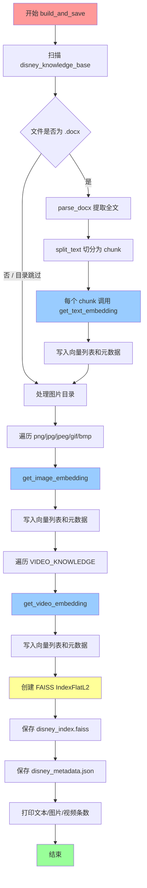
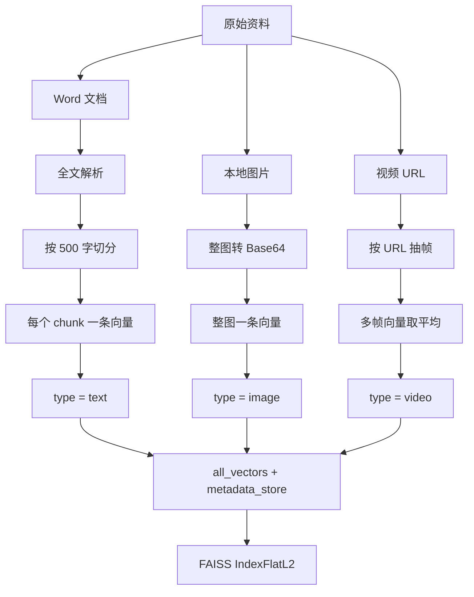
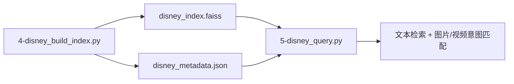

# 迪士尼RAG助手 - 知识库构建逻辑

`4-disney_build_index.py` 负责把文档、图片、视频统一向量化，并写入本地 FAISS 索引。后续查询脚本 `5-disney_query.py` 直接加载这两个产物做检索。

**核心功能：**

- 解析 Word 文档，按固定长度切分成 chunk
- 用同一套多模态 Embedding 模型处理文本 / 图片 / 视频
- 把向量写入 FAISS，把原文和媒体路径写入 JSON 元数据

---

## 1. 配置参数

```python
DASHSCOPE_API_KEY          # 环境变量，未设置则直接报错退出
MULTIMODAL_EMBEDDING_MODEL = "tongyi-embedding-vision-plus"
DOCS_DIR                   = "disney_knowledge_base"
IMG_DIR                    = "disney_knowledge_base/images"
INDEX_FILE                 = "disney_index.faiss"
METADATA_FILE              = "disney_metadata.json"
CHUNK_SIZE                 = 500   # 每个文本 chunk 的字符数
CHUNK_OVERLAP              = 50    # 相邻 chunk 重叠字符数
```

视频不读本地文件，而是用预置的 URL 列表：

```python
VIDEO_KNOWLEDGE = [
    {
        "url": "https://dataset-1255932437.cos.ap-nanjing.myqcloud.com/mp4/car.mp4",
        "description": "汽车剐蹭视频"
    }
]
```

通义多模态向量化目前只支持视频 URL，不支持直接传入本地视频文件。

---

## 2. 主流程



三条入库链路共用同一套计数器 `doc_id`，最终落在同一个向量空间里，查询时才能用一次 FAISS 搜索同时命中文本、图片和视频。

---

## 3. 函数说明

### 3.1 `parse_docx(file_path)` — 解析 Word

按文档 body 的原始顺序遍历元素，而不是只读 `doc.paragraphs`，这样表格不会丢。

| 元素类型 | 处理方式 |
| --- | --- |
| 段落 `p` | 取出全部 `w:t` 文本节点，拼成一段 |
| 表格 `tbl` | 转成 Markdown 表格（首行作表头，第二行写分隔线） |
| 空段落 | 丢弃 |

最后用换行符把所有段落和表格拼成一篇完整文本。

### 3.2 `split_text(text)` — 固定长度切分

```
窗口长度 = 500
重叠长度 = 50
每次前进  = 500 - 50 = 450
```


空 chunk（全是空白）会被丢掉。重叠是为了避免一句话被从中间切断后，检索时语义断裂。

### 3.3 `get_text_embedding(text)` — 文本向量

调用 `dashscope.MultiModalEmbedding`，输入格式：

```python
input=[{'text': text}]
```

返回 `resp.output['embeddings'][0]['embedding']`。失败则抛异常。

### 3.4 `get_image_embedding(image_path)` — 图片向量

不再做 OCR。多模态模型直接吃图片语义。

1. 读取本地图片，转成 Base64
2. 扩展名 `jpg` 统一改成 `jpeg`
3. 拼成 Data URI：`data:image/{ext};base64,{...}`
4. 调用 Embedding：`input=[{'image': image_data}]`

### 3.5 `get_video_embedding(video_url)` — 视频向量

输入是远程 URL，不是本地路径：

```python
input=[{'video': video_url}]
```

模型可能对视频抽多帧，返回多条 embedding。这时对所有帧向量做均值，压成一条：

```python
if len(embeddings) > 1:
    vectors = [np.array(e['embedding']) for e in embeddings]
    return np.mean(vectors, axis=0).tolist()
return embeddings[0]['embedding']
```

一条视频在索引里只占 1 条记录。

---

## 4. 三种模态如何入库



### 元数据结构

文本 chunk：

```json
{
  "id": 0,
  "source": "门票政策.docx",
  "type": "text",
  "content": "切分后的文本内容..."
}
```

图片：

```json
{
  "id": 12,
  "source": "图片: 2-万圣节.jpeg",
  "type": "image",
  "path": "disney_knowledge_base/images/2-万圣节.jpeg",
  "content": "[图片] 2-万圣节.jpeg"
}
```

视频：

```json
{
  "id": 15,
  "source": "视频: 汽车剐蹭视频",
  "type": "video",
  "url": "https://...",
  "description": "汽车剐蹭视频",
  "content": "[视频] 汽车剐蹭视频"
}
```

`id` 与 FAISS 里的向量下标一一对应。查询时先拿到最近邻的下标，再回查这份 JSON。

---

## 5. FAISS 索引怎么建

```python
dim = len(all_vectors[0])          # 以第一条向量的维度为准
index = faiss.IndexFlatL2(dim)     # 精确 L2 距离，不做近似
index.add(np.array(all_vectors).astype('float32'))
faiss.write_index(index, "disney_index.faiss")
```

`IndexFlatL2` 是暴力精确检索：数据量不大时足够，查询侧用 `1 / (1 + L2距离)` 转成相似度。

产出两个文件：

| 文件 | 内容 |
| --- | --- |
| `disney_index.faiss` | 全部向量 |
| `disney_metadata.json` | 每条向量对应的原文 / 路径 / URL |

---

## 6. 目录扫描规则

扫描 `disney_knowledge_base` 时：

- 以 `.` 开头的文件跳过
- 子目录（例如 `images`）跳过，避免把图片目录当文档处理
- 只处理扩展名为 `.docx` 的文件

扫描 `disney_knowledge_base/images` 时：

- 只处理 `.png` / `.jpg` / `.jpeg` / `.gif` / `.bmp`

---

## 7. 和查询脚本的衔接



构建侧把三种模态压进同一索引；查询侧再按 `type` 过滤：文本取 Top-k，图片/视频再加距离阈值。
